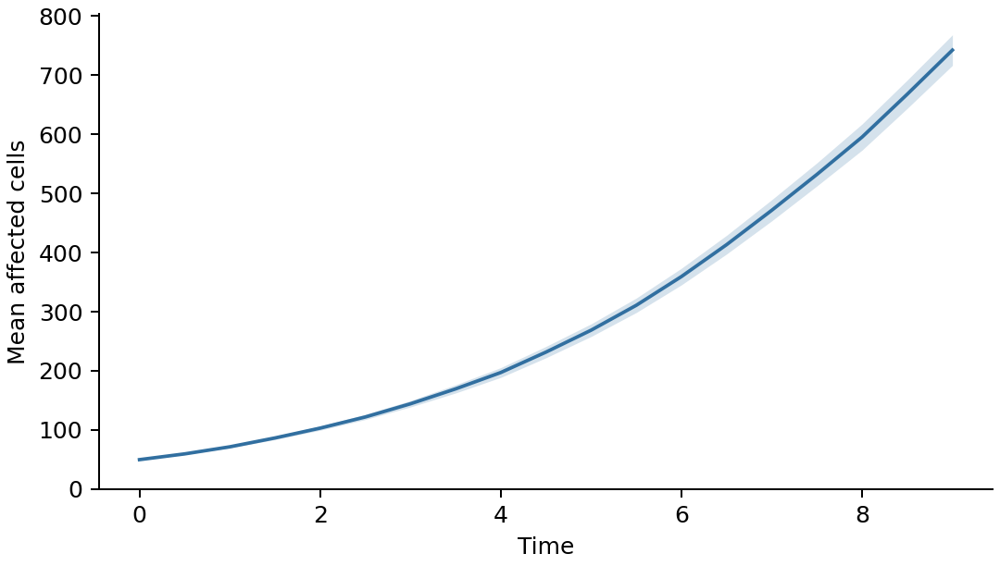

# pixel-SIS

Finite-population SIS simulations on voxel-level brain connectivity, with separate
code for the dynamics, measurements, parameter fitting, and scientific figures.

The current mouse reference uses a 100 µm grid, an Allen tracer-derived connectivity
model, a MERFISH-derived population prior, and an optional local contact kernel.
It simulates the count CTMC directly using event-based thinning. There is no
mean-field closure or integration time step in the stochastic simulator.

This public release packages the **homogeneous SIS model with an immediate
pathology readout**. The section-level measurement model discussed in
[the observation roadmap](docs/observations.md) is work to be done, not an
implemented or validated result.

## Install and try it

Python 3.9–3.12 is supported. Numerical dependencies are pinned to the research
environment; the local reference checks use Python 3.9 and CI also tests 3.12.

```bash
git clone https://github.com/gretarsson/pixel-sis.git
cd pixel-sis
python -m venv .venv
source .venv/bin/activate
python -m pip install --upgrade pip
python -m pip install -e '.[dev]'

export OPENBLAS_NUM_THREADS=1
export OMP_NUM_THREADS=1
export VECLIB_MAXIMUM_THREADS=1
pixel-sis demo --out results/demo --runs 64
```

The demo is a synthetic three-community example and needs no experimental data.
It writes an ensemble, the parameter settings, and a plot of the mean trajectory.
Output directories must be new, so an experiment cannot silently overwrite another.



## Model

For affected count $I_i$ and fixed population $N_i$ in voxel $i$,

$$
\lambda_i(I)=\left(1-\frac{I_i}{N_i}\right)
\sum_j \left(\beta_T Q_{ji}+\beta_L L_{ji}\right)I_j,
\qquad \mu_i(I)=\gamma I_i.
$$

Rows are sources and columns are destinations. The reference $Q$ preserves
tracer-derived strength and uses cell-level edge reversal, not a bare matrix
transpose. $L$ is a population-weighted Gaussian neighborhood kernel, normalized
per source and including within-voxel contacts. The parameters are uniform over
the modeled brain. See [the model definition](docs/model.md) for the exact choices.

The count process is exact for this specified compartment/contact model. The
tracer-derived contacts and within-voxel homogeneity are modeling assumptions;
they are not measured individual synapses.

## Run the mouse reference

The prepared reference data stay outside version control. Set `PIXEL_SIS_DATA`
to the directory containing the files listed in [data.md](docs/data.md).
Existing research users can point this directly at their `tracer_sis/data` directory.

```bash
export PIXEL_SIS_DATA=/path/to/prepared/reference
pixel-sis simulate --data "$PIXEL_SIS_DATA" \
  --config examples/mixed.json --observations --out results/mixed
pixel-sis plot --data "$PIXEL_SIS_DATA" \
  --simulation results/mixed/ensemble.npz --out results/mixed/slices
pixel-sis plot --data "$PIXEL_SIS_DATA" \
  --simulation results/mixed/ensemble.npz --out results/mixed/regional --regional
```

`examples/` includes local-only, tracer-only, mixed, and higher-tracer-rate settings.
The rates and random seeds reproduce the recent manual experiments. The sampler
records event counts, runtimes, voxel means, Monte Carlo standard errors, and
regional samples. It raises an error if the attempt limit is reached.

The plot places the model directly above the regional measurements at each slice.
It uses one fixed color scale; gray is missing regional coverage. Regional values
painted on an atlas are not raw section images. `--regional` applies the same
regional averaging to the model before displaying it.

## Fit the current regional readout

```bash
pixel-sis fit --data "$PIXEL_SIS_DATA" \
  --config examples/fit_tracer.json --out results/fit-tracer
```

The fitter uses bounded multistart Nelder–Mead and the existing weighted regional
squared-error objective. By default it profiles one global observation scale
analytically. Set `observation_scale_um` in the fit configuration to hold the
conversion fixed, for example for an explicit section-depth approximation.
Searches share a fixed set of random seeds; fresh simulation ensembles compare
the finalists. Convergence flags and evaluation limits are saved. This portable
fitter does not reproduce the historical search's initial screening schedule,
and does not claim a global optimum.

The global observation scale converts modeled affected-cell density into measured
cell-body profiles per section area. It is an empirical conversion. A more explicit
section sampling/detection model is planned; no biological delay has been added.

The [self-contained model and fit report](docs/report/pixel_sis_report.pdf) explains
the inputs, CTMC, measurement units, fitting procedure and limitations. Its new
fixed-depth experiment assumes ideal cell-center counting in 6 µm sections. This
is a first approximation to profile counting, not calibrated stereology.
`examples/run_section_fits.py` reproduces those fits with the prepared mouse bundle;
`examples/analyze_section_fits.py` generates the comparison figures and metrics.
For just the fixed-depth mixed fit, use `pixel-sis fit` with
`examples/fit_fixed_depth.json`. The full reference searches take tens of minutes
on one CPU; the synthetic demo is the quick installation check.

## Python API

```python
import numpy as np
from pixel_sis import Rates, from_contacts, simulate_ensemble

model = from_contacts(
    population=[100, 100],
    initial=[5, 0],
    tracer=[[0.9, 0.1], [0.1, 0.9]],
)
ensemble = simulate_ensemble(
    model, np.linspace(0, 9, 19), Rates(0.4, 0.0, 0.1), runs=256, seed=1234
)
```

## Tests and provenance

```bash
ruff check src tests
pytest -q
# Optional full mouse-reference regression:
PIXEL_SIS_REFERENCE_DATA="$PIXEL_SIS_DATA" pytest -q -m reference
```

Tests compare small-network ensembles with independently constructed finite-state
master equations, check the microscopic/count-process identity, validate observation
weighting and missing data, and exercise fitting on a synthetic target. Optional
reference tests compare complete seeded trajectories against pre-cleanup results.

The public tree includes code, examples, input schemas, checksums, and tests.
Experimental archives, images, generated research results, local environments,
credentials, and historical scripts are excluded. The full prepared mouse bundle
is not distributed here; this release reads that bundle rather than implementing
its complete raw-data preparation pipeline.

## Sources and license

- [Allen voxel connectivity model](https://download.alleninstitute.org/publications/A_high_resolution_data-driven_model_of_the_mouse_connectome/)
- [Knox et al., A high-resolution data-driven model of the mouse connectome](https://doi.org/10.1162/netn_a_00066)
- [Allen Brain Cell Atlas MERFISH data](https://alleninstitute.github.io/abc_atlas_access/descriptions/MERFISH-C57BL6J-638850.html)
- [Published regional pathology analysis](https://github.com/jkbrynildsen/aSyn_spread/tree/895dc66cf16a3419c8018a3c7f40b08a035ca7fe)

Code is released under the [MIT license](LICENSE). External datasets retain their
own terms and attribution requirements. This repository contains no vendored
third-party packages.
